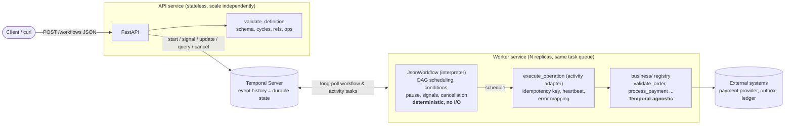

# Architecture and design decisions

## 1. Overview

| Layer | Package | Knows about Temporal? | Contains |
|---|---|---|---|
| Definition | `wfengine/validation.py`, `schema/` | No | Parsing, validation, topological order |
| Orchestration | `wfengine/workflows.py`, `dag.py` | Yes (deterministic APIs only) | Scheduling, conditions, templates, signals |
| Adapter | `wfengine/activities.py` | Yes | Idempotency key, heartbeat, error mapping |
| Business | `business/` | **No** | Operations that touch the outside world |
| Delivery | `wfengine/api.py`, `worker.py` | Yes | HTTP API, worker process |

The engine is **not** a JSON-to-function mapper. There is exactly one workflow type (`JsonWorkflow`). The JSON is *data* it interprets: each step becomes an asyncio task inside the workflow that waits for its dependencies, then schedules the generic `execute_operation` activity. Because tasks run on Temporal's deterministic event loop, parallel branches are genuinely concurrent and every scheduling decision is recorded in history.

## 2. Worker architecture

* The worker is a separate process (`python -m wfengine.worker`) from the API. It long-polls Temporal for workflow tasks and activity tasks on one or more **task queues** (`TASK_QUEUE`, or `TASK_QUEUES=a,b`). Steps can also be routed to a different queue (`task_queue` on a step or in `defaults`), e.g. a `gpu` or `payments` fleet with different credentials.
* **Scale out** by running more replicas on the same queue (`docker compose up -d --scale worker=3`). Temporal's matching service load-balances tasks across pollers; workers keep no local durable state, so any replica can run any task. Tune with `WORKER_MAX_CONCURRENT_ACTIVITIES` / `..._WORKFLOW_TASKS`.
* **Graceful shutdown**: on SIGTERM the worker stops polling, lets in-flight activities run for `GRACEFUL_SHUTDOWN_SECONDS`, then cancels them. A cancelled attempt is simply retried elsewhere; idempotency makes that safe. `stop_grace_period` in compose exceeds the drain time so Docker does not SIGKILL first.
* **Crash detection**: every activity heartbeats (every 2 s) and has a `heartbeat_timeout` (default 30 s, configurable per step). A killed worker stops heartbeating, Temporal times the attempt out in seconds rather than waiting for `start_to_close`, and the retry policy schedules a new attempt on a healthy worker. Heartbeats are also how cancellation is delivered to a running activity.

## 3. Challenges

### A. Recovery after a worker crash
Temporal persists an append-only **event history** per workflow (workflow started, activity scheduled/started/completed, timers, signals...). Worker memory is just a cache. After a crash, a new worker receives the workflow task, **replays** the history through `JsonWorkflow`: when replay reaches `execute_activity` for a step whose `ActivityTaskCompleted` event exists, the SDK returns the recorded result *without running the activity again*. The workflow code therefore rebuilds exactly the same in-memory state and continues from the first unrecorded event. Only the activity attempt that was in flight at the time of the crash is retried.

Demonstrated by `tests/test_worker_crash.py` (real subprocess killed with `os._exit(137)`) and `scripts/demo_crash.sh` (docker). The assertions: `validate` invoked once, `payment` invoked twice, one charge.

### B. Idempotency (including "external API succeeded, worker crashed before recording")
Temporal gives **at-least-once** activity execution. Exactly-once *effects* come from three layers (`business/operations.py`):

1. **Stable idempotency key** = `sha256(workflow_id, step_id)`. It does not change across attempts, worker restarts, or re-runs of a failed workflow under the same business id (it deliberately excludes `run_id` and attempt number).
2. **Provider-side deduplication**: the key is sent to the external system (Stripe-style `Idempotency-Key`). A repeated call returns the *original* result.
3. **Local ledger** (`operation_results`, first-writer-wins): finished work short-circuits; concurrent duplicates agree on a single result.

*The crash window*: attempt 1 calls the provider (charge succeeds) and dies before step 3. Attempt 2 finds no ledger entry, calls the provider again **with the same key**, gets the **same charge** back, records it, returns. One charge. Tested without a server in `tests/test_idempotency.py` and end-to-end in `test_worker_crash.py` / `test_result_lost_after_external_success_in_a_real_workflow`.

*If a provider offers no idempotency keys*: look the operation up by a business reference before acting (check-then-act), or write an outbox row in the same DB transaction as the business change and let a relay deliver it. A true no-dedupe, no-lookup API cannot be made exactly-once by anyone; the honest answer is to detect and reconcile.

**Duplicate submission** is a separate layer: `workflow_id` is the business key. The API describes the id first (same definition hash → returns the existing run with `duplicate: true`, different definition → `409`), and `start_workflow` uses `WorkflowIDConflictPolicy.USE_EXISTING` so simultaneous submissions race inside Temporal and exactly one wins. `ALLOW_DUPLICATE_FAILED_ONLY` lets a failed/cancelled workflow be resubmitted (ledger keys make already-finished steps no-ops) but never re-runs a completed one.

### C. Parallel execution and partial failure
Independent steps are independent asyncio tasks, so they run concurrently (test asserts overlapping intervals). When one branch fails fatally:

| `failure_policy` | Behaviour |
|---|---|
| `fail_fast` (default) | No new steps start; in-flight siblings are **cancelled** (activity cancellation is delivered via heartbeat and awaited with `WAIT_CANCELLATION_COMPLETED`, so the workflow does not close while work is still running). Not-yet-started steps become `cancelled`. |
| `wait_all` | Independent siblings finish; dependants of the failed step are `skipped`; the workflow then fails. |

Either way the failure carries the full per-step state and outputs (`ApplicationError.details`), so partially completed work is visible. Per-step `on_failure: continue` records the failure but lets the workflow finish as `COMPLETED_WITH_ERRORS`; `trigger_rule: all_done` runs cleanup/join steps regardless of upstream outcome.

### D. Validation
`validate_definition` collects **all** problems (code + JSON path + message): malformed structure, unknown fields, duplicate ids, unsupported step types, unknown operations (checked against the registry), missing and self dependencies, cycles (reported as `a -> c -> b -> a`), bad retry/timeout values, invalid conditions, and `${...}` references to steps that are not ancestors (which would be a race). It runs in the API (HTTP 400 for unparsable JSON, 422 for semantic errors, nothing started) **and** again at the top of the workflow, because a definition can reach Temporal through other clients.

### E. Long-running waits
A `wait_signal` step does `workflow.wait_condition(...)`: no thread, no polling, no worker resource is held. The workflow can wait days. Signals are accepted and persisted even when **no worker is running**; a restarted worker replays history and sees the signal. Signals are buffered (an early signal is not lost) and `event_id` dedupes redelivered webhooks. Timeouts are optional per step. `test_waiting_workflow_survives_worker_restart` stops the worker, sends the signal while nothing is polling, starts a new worker, and checks completion and that earlier steps did not re-run. History size is bounded by the step count (max 500), so continue-as-new is unnecessary for DAGs; a looping variant would need it.

### F. Determinism
Workflow code is replayed, so it must produce the same commands from the same history.

| Belongs in the **workflow** | Belongs in an **activity** |
|---|---|
| Scheduling order (stable topological order, never set/dict hash order) | Any network/DB/file I/O |
| Condition evaluation and template resolution (pure functions over recorded results) | Wall-clock time, randomness, UUIDs |
| Timers (`workflow.sleep`), waiting (`wait_condition`), concurrency (asyncio on Temporal's loop) | Reading environment/config that can change |
| `workflow.now()` for timestamps | The idempotency key derivation and all business logic |

Enforcement: Temporal's **sandbox** blocks non-deterministic stdlib use at import/run time; there is **no `eval`** (conditions are a JSON DSL); `tests/test_integration.py::test_history_replays_deterministically` records a complex run (parallel, condition, signal, timer, failure) and replays it through the code with `Replayer`; run that same replay in CI against histories exported from production (`temporal workflow show --output json`) before every deploy.

## 4. The "final review" questions

| Question | Answer |
|---|---|
| How is state rebuilt after a restart? | Event-history replay (section 3A). Worker memory is a cache; the history is the truth. |
| Activity completed but workflow never got the result? | The worker's `RespondActivityTaskCompleted` failed, so Temporal never recorded completion; the attempt times out (heartbeat/start-to-close) and is retried. At-least-once delivery means the business effect may have happened. That is exactly why every operation is idempotent (3B). |
| Duplicate external side effects? | Stable key + provider dedupe + ledger + workflow-id uniqueness. |
| Definition changes while old executions run? | The definition is the workflow's **input**, stored in history. In-flight runs keep the definition they started with; a new definition is a new submission. Same `workflow_id` + different content gets `409`; use a new id or a versioned id (`order-123-v2`). The `version` field and a `definition_hash` memo make versions traceable. |
| Scale workers horizontally? | More replicas per task queue (stateless); separate queues for isolation; tune concurrency per worker; scale Temporal itself via history shards. |
| Incompatible *interpreter* (code) versions? | Because there is one generic workflow, interpreter changes are rare. For command-affecting changes use `workflow.patched("change-id")` / `deprecate_patch` so old histories replay on the old branch, or **Worker Versioning** (pin running executions to the build that started them, drain, retire). Gate deploys on replay tests of real histories. Never edit the order/number of commands in place. |
| Prevent nondeterminism? | Section 3F: sandbox + pure helpers + no eval + replay tests in CI. |

## 5. Trade-offs and known limits

* **Single generic activity** (`execute_operation`) keeps the engine data-driven but loses per-activity typing and per-operation timeouts at the worker level (timeouts are per step, in JSON). The registry is in-process; adding an operation means deploying a worker.
* **Validation against the registry** happens in the API process, which imports `business`. If workers for other queues own other operations, drop `STRICT_OPERATIONS` or serve the registry from a shared source.
* **Step outputs live in workflow history/state.** Temporal limits payloads (~2 MB per payload, ~50 MB history). For big data, return references (S3 keys), not blobs; add a payload codec for encryption/compression.
* **SQLite** stands in for the business databases so the demo is self-contained; it works across processes on one host/volume. Production: Postgres, with the ledger insert in the same transaction as the business change.
* **Compose uses the Temporal dev server** (single node, SQLite file). Production uses a clustered Temporal (Postgres/Cassandra + Elasticsearch/visibility) or Temporal Cloud, mTLS, and namespace retention policy.
* **No compensation (saga) steps yet.** Cancellation marks work cancelled but does not undo completed steps. The natural extension is a `compensate` block run in a detached cancellation scope.
* **Query on closed workflows** needs a running worker; the status API falls back to the workflow result / failure details when none is available.
* **Fault injection** (`_fault`) is gated by `ENABLE_FAULT_INJECTION=1` and must be off in production.
